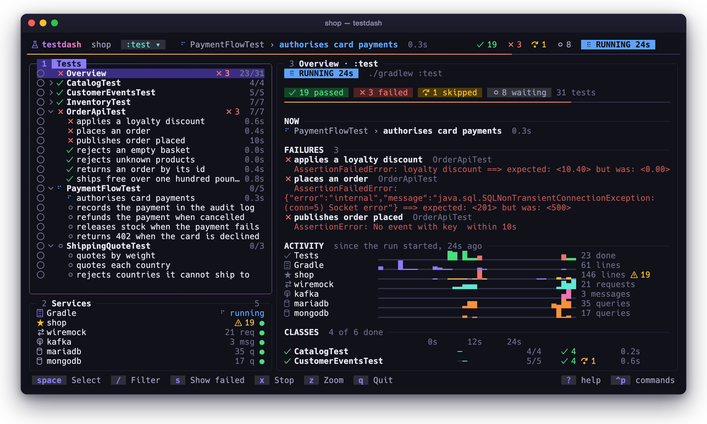
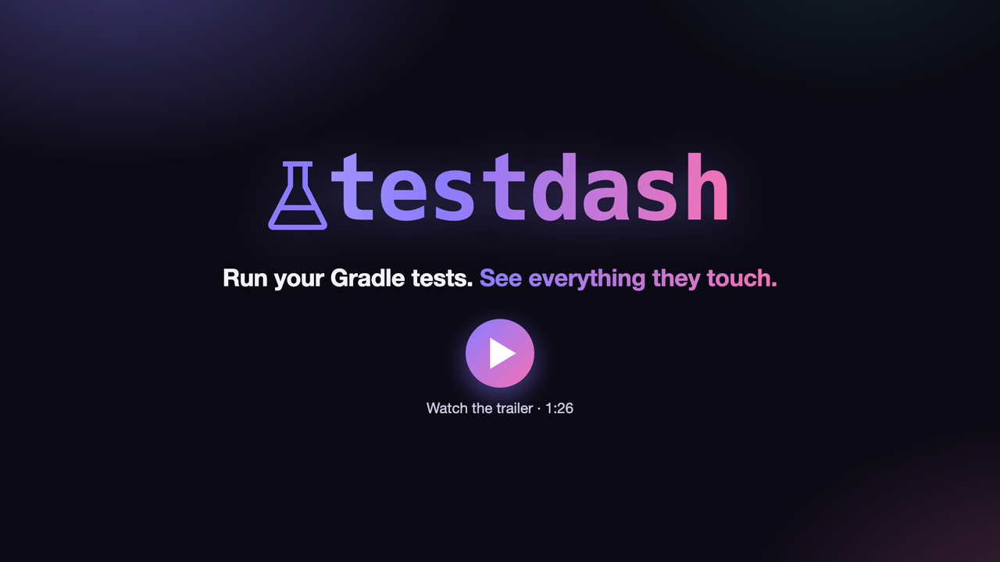
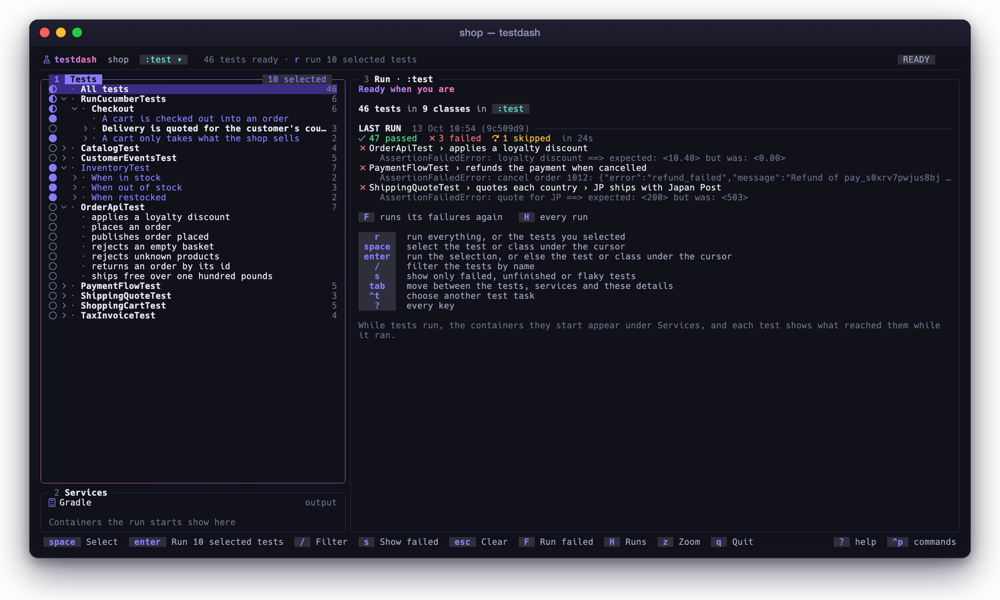
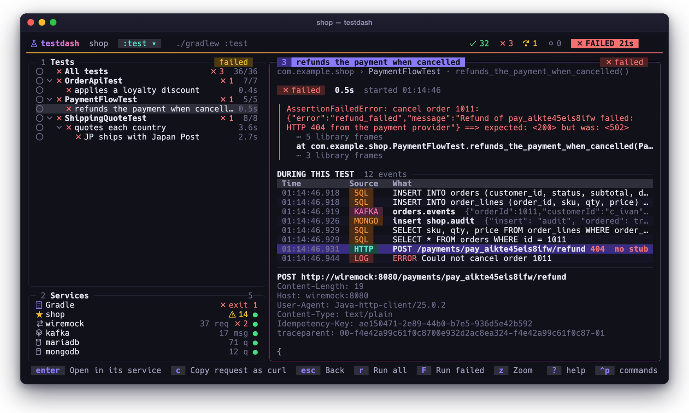
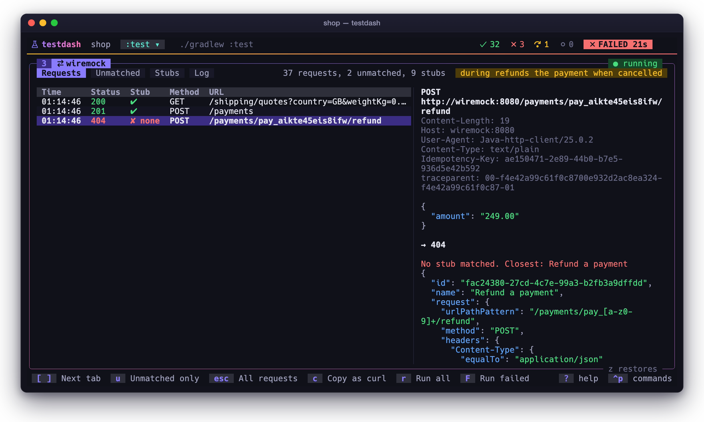
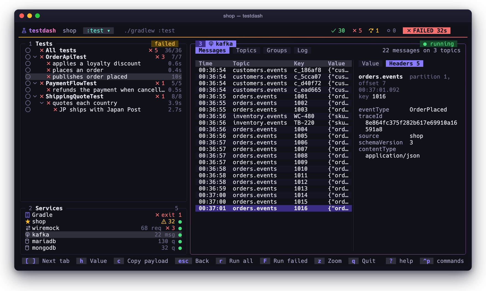
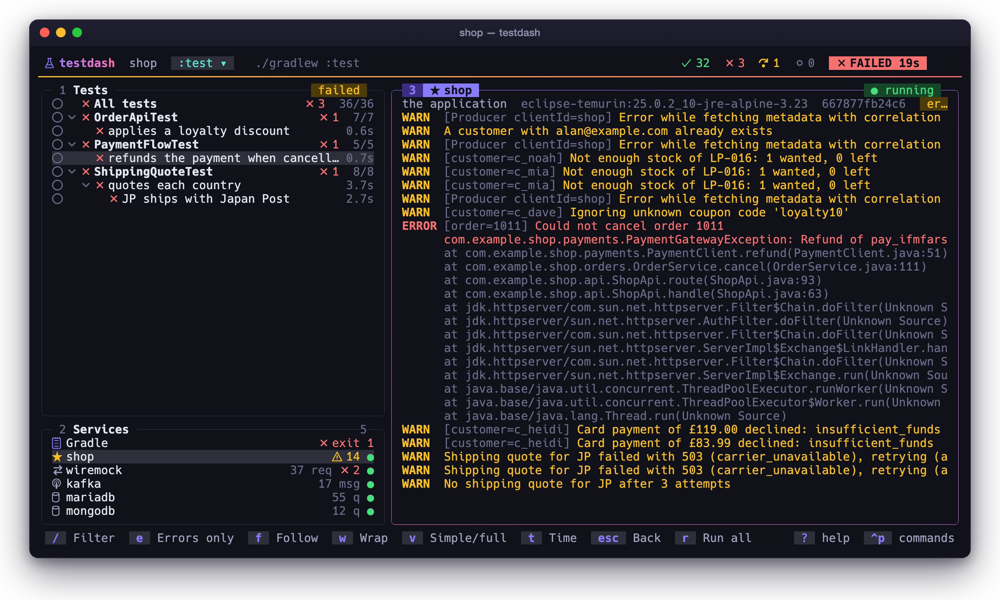
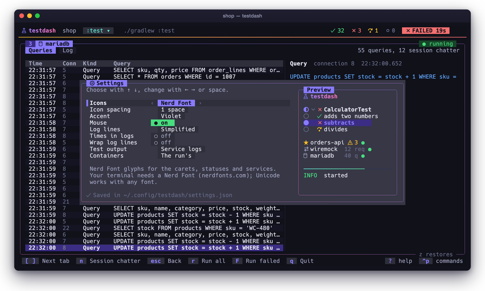

# testdash

<p align="center">
  
</p>

Pick tests, run them, and follow everything the run touches, in one terminal app. It works in any Gradle
repo with no configuration: it lists the build's tests itself, and finds the application, WireMock, databases
and brokers the tests start through Docker.

testdash is a single Go binary built with [Bubble Tea](https://github.com/charmbracelet/bubbletea) and
[Lip Gloss](https://github.com/charmbracelet/lipgloss). It paints its own dark theme, so it looks the same in
any terminal, and shows a run's progress in the terminal's tab or taskbar where the terminal supports it.

<p align="center">
  <a href="docs/trailer.mp4"></a>
</p>

## The screen

One screen, in three panels, with the run along the top.

**The header** says what you are testing and how the run is going: the test running now, the counts so far,
and a badge (ready, running, passed or failed). A line under it fills as tests finish, green while all is well
and red once one fails. Click the task to choose another.

**1 · Tests** is the task's tests by class, including `@Nested` classes and parameterised tests, each with its
result and time from the last run. The first row, *All tests*, is the run as a whole, and while a run goes it is its *Overview*. `space` selects a test or
a class (`●` marks what is selected, `◐` a class partly selected), and `enter` or `r` runs the selection. With nothing selected, `enter` runs the
test or class under the cursor and `r` runs everything. `/` filters by name (case, spaces and punctuation ignored) and `s` shows
only the failed or unfinished tests, or the flaky ones (marked `≈`). `H` lists the runs before, each with its
failures, which `enter` runs again; a test's details show its last results, and after a run the overview says
what changed since the last one.

<p align="center">
  
</p>

**2 · Services** is Gradle's output and every container the run started: the application (★) first, then
WireMock, Kafka, databases and the rest, each with a word on what it has seen (warnings, requests, messages,
queries) and a dot for whether it runs.

**3 · Details** shows whatever is selected in the panel you were last in:

- *All tests* or *Overview*: the run's dashboard: its results, what is running now, the failures with their messages, a
  sparkline for each source (tests finishing, Gradle, each log, requests, messages, queries) over the run,
  every class on the run's time line (its setup a thin line, then each test coloured by how it did), and while
  it runs, a live feed of the newest from the build and the services. Once it is done, the slowest tests.
  Before the first run, the last run kept, with its failures (`F` runs them again), and the keys that get you
  started.
- *A class*: its results and its tests' times as bars.
- *A test*: its result, its failure with the stack trace (your own frames bright, library frames folded), and
  **what happened during it**: every HTTP request WireMock received, Kafka message, SQL or MongoDB query, Redis
  command, and warning or error the application logged while it ran, in time order. Select one to see all of
  it below; `enter` opens it in its service's view, narrowed to the test's time, and `c` copies it: a request
  as a curl command, a query or command, or a message's payload. On a failed test, `c` copies its failure. `t`
  groups the events by the trace they belong to (from `traceparent` and B3 headers, Spring Boot's log
  correlation and sqlcommenter comments): each trace with all of its events in the run, those after the test as
  well, as a consumer or a scheduled job goes on with it, and the application's log lines that carry it.
- *Gradle or a service*: its log, or WireMock's requests (with the closest stub for each unmatched one), stubs
  and log; Kafka's messages (each with its value and headers), topics, consumer group lag and log; a database's
  queries or Redis's commands, and log. A SQL query shows laid out over lines and coloured, or as the database
  logged it (`v`); JSON is coloured wherever it shows. `c` copies the request as curl, the query, the command
  or the message's payload. `t` on a request, message or query that carries a trace narrows every service to
  that trace, logs included (a right click on a log line offers it too); `t` or Esc shows every trace again.

<p align="center">
  
</p>
<p align="center">
  
</p>
<table>
  <tr>
    <td></td>
    <td></td>
  </tr>
</table>

`tab` moves between the panels, and `1`, `2` and `3` go straight to one. `z` gives the details the whole width,
and on a narrow terminal the lists and the details take turns. Esc goes back: it clears a filter or a test's
time first. The mouse works everywhere: click a row, a panel, a tab, the task or a footer key, and scroll with
the wheel. In the tests, a click on a row's mark selects it, a click on a caret (or a second click on a class)
opens or closes it. `?` lists every key and `ctrl+p` (or `:`) finds any command.

**Logs** are simplified: each line shows its level and message, without the timestamp, process id, thread and
logger, and stack traces sit indented under the line that logged them. MDC values a pattern puts before the
message (`[reference=…]`) stay, dimmed. `v` shows lines as they were logged and `t` adds the time Docker
received each one; both apply to every log. testdash reads Spring Boot's console format (2.x, 3.x, and 3.2+
with the application name and correlation id), Logback and Log4j 2's usual patterns, JSON logs (Spring Boot's
structured Logstash, ECS and GELF output, and MongoDB's), Kafka, MariaDB/MySQL, Postgres and Redis, and any
line that starts with a timestamp. Lines in other formats are shown as they are. A log follows new lines until
you scroll up; End or `f` follows again.

**Noise** is what health checks, connection pools and the like send. The databases' session chatter is noise
from the start; rules of your own hide anything else. `N` on a request, message, query or a test's event, or a
right click on it or on a log line, opens a rule for things like it: a regular expression over its text, its ids
and numbers generalised, showing what it matches as you type. A rule is for that service or every service, and
saved in the build's `.testdash.json`, to share with the team, or in the settings for every build. Noise leaves
the views, a test's events, the activity and the counts; `n` shows it again in any view, and *Noise filters* in
the palette lists the rules with what each hides now, to change or remove. A right click anywhere offers what
can be done with what is under the pointer.

When the run cannot start its containers because a port is taken, as when another run of the same Compose
file is up, the dashboard says which container (or process) holds the port.

| Where | Keys |
|---|---|
| Anywhere | `tab` next panel · `1` `2` `3` tests, services, details · `r` run the selection, or all · `F` run the failed tests (before a run, the last run's) · `x` stop (twice kills) · `z` zoom the details · `c` the run's whole command · `H` the runs before · `ctrl+t` test task · `ctrl+p` or `:` commands · `ctrl+s` settings · `?` keys · `q` quit, after asking · a right click offers what can be done with what is under it |
| Tests | ↑/↓ move · ←/→ collapse, expand · `space` select · `a` select all shown · `u` unselect the tests that passed · `enter` run the selection, or with none, this test or class · `/` filter · `s` all, failed, not passed or flaky · Esc clears the filter, then the selection |
| A test's details | ↑/↓ the events while it ran · `enter` open the event in its service · `t` by trace or in time order · `c` copy it · `N` hide things like it as noise · `tab` the event, the stack trace · Esc back |
| Logs | `/` filter (regex, on the whole line) · `e` errors only · `f` follow · `w` wrap · `v` simplified or full lines · `t` time · `n` show the noise · `N` hide what the filter finds as noise · ←/→ scroll sideways · Home/End |
| Services | `[` `]` or ←/→ tabs · ↑/↓ a row, its details beside it · `n` show the noise · `N` hide things like the row as noise · `c` copy it · `t` every service to the row's trace, or every trace again · WireMock `u` unmatched only · Kafka `h` a message's headers or value, `enter` on a topic shows its messages · SQL `v` formatted or raw |

## Settings

`testdash --settings` opens the settings on their own screen, and `ctrl+s` opens them inside testdash, where
changes apply at once. Each change is saved to `~/.config/testdash/settings.json` (or under
`$XDG_CONFIG_HOME`).

<p align="center">
  
</p>

| Setting | |
|---|---|
| Icons | Unicode, or [Nerd Font](https://www.nerdfonts.com) glyphs for the carets, statuses and services, chosen to sit at the size of the text. A Nerd Font must be your terminal's font. |
| Accent | The colour of focus and selection: Violet, Ocean, Sunset or Rose. |
| Mouse | Off leaves the mouse to the terminal, to select and copy text. |
| Log lines, times, wrapping | How logs start: simplified or as logged, with or without times, wrapped or not. |
| Test output | Whether tests' own output also goes into Gradle's output (as `--show-test-output`). |
| Containers | The run's containers, or every container on the machine (as `--all-containers`). |
| Notifications | A desktop notification when a run ends, through the terminal (iTerm2, WezTerm, Ghostty, kitty, Windows Terminal and more): while you are in another window (the default), always, or never. |
| Integrations | WireMock, Kafka, MariaDB and MySQL, Postgres, MongoDB and Redis can each be hidden: testdash then leaves those containers alone, without listing or following them or switching on their logging. `hiddenServices` in the file takes any kind, such as `zookeeper`. |

## Use

Install it with Go 1.26 or later, which puts it in `$(go env GOPATH)/bin`:

```sh
go install github.com/steven509/testdash@latest
```

From a clone, `go build -o ~/.local/bin/testdash .` puts it wherever you like on your PATH.

It needs Docker for the service views, and Gradle builds need a JDK (`JAVA_HOME` or `javac` on PATH) to compile
the JUnit listener once.

```sh
testdash                                   # in a Gradle repo: pick from its tests
testdash --task :app:blackBoxTest          # start on a task
testdash :app:test --tests '*OrderApiTest' # run these at once, as gradlew would
testdash --info                            # arguments testdash does not know are passed to Gradle
testdash -- npm test                       # any other command: no test list, the service views still work
```

`TESTDASH_KEYCAST=1 testdash` shows each key you press, and what it did, at the bottom of the screen, for screen
recordings and demos; `TESTDASH_KEYCAST=shortcuts` shows only the shortcuts, leaving out moving and typing.

A task path and Gradle's `--tests` filters (as many as you like, with `*` wildcards, a class or a class and
method, the package left out when the pattern starts with a capital) skip picking: the run starts at once, and
the tests it matches are selected, so `r` runs them again. When the tests have not been listed yet, testdash
lists them first.

`--show-test-output` keeps test stdout in Gradle's output (by default the service views show it), and
`--all-containers` follows every container on the machine rather than only the run's; both are settings too.
`testdash --settings` changes the settings.

A `.testdash.json` at the repo root (found from the current directory up to the git root) is optional:

```json
{
  "task": ":app:blackBoxTest",
  "logs": [{ "name": "app.log", "file": "build/app.log" }]
}
```

`command` (a list or a string) replaces the Gradle task, `showTestOutput` is the flag above, `logs` adds
views for a `file` or a `command`'s output, and `noise` holds the build's noise rules, each a `match` regex and
an optional `service`, as testdash saves them.

## How it works

**The test list** comes from JUnit Platform's discovery API, so it is exactly what a run would execute. A
Gradle init script (`internal/gradle/junit/testdash.init.gradle`) adds a `testdashDiscover` task that compiles
each Test task's tests and discovers them (`internal/gradle/junit/Discover.java`) without running them or the
Test task's other dependencies. The result is cached, so the picker opens at once and refreshes in the
background. A selection becomes `--tests` filters; a whole class also selects its `@Nested` classes.

**Progress** comes from a JUnit listener (`internal/gradle/junit/TestdashListener.java`) the same init script
puts on every Test task, without changing the build. Both are embedded in the binary, compiled once against JUnit
jars from your Gradle cache (under `GRADLE_USER_HOME` when that is set), using only JUnit Platform 1.0 API, and
kept in `~/.cache/testdash`.

**Services** are the containers the run started. When the tests use Testcontainers, the listener reports the
labels Testcontainers will clean up by, its session id and each Compose project's name (registered before the
project starts), and only containers with those are taken, so another run's stay out even when it uses the same
Compose file. Otherwise they are the containers created while the run went that Testcontainers labelled, or
whose Compose file lives in the repo; before the first run there are none. Each is named after its Compose service; its
image says what it is (WireMock, MongoDB, MariaDB, MySQL, Postgres, Kafka, Redis and more), anything else is the
application, and Testcontainers' own helpers are hidden. Logs are kept after the containers are removed.

**WireMock** is read through its admin API (`/__admin/requests`, `near-misses`, `mappings`) with `docker exec`
and the container's own curl, since Testcontainers rarely publishes its port. The journal is read four times a
second and every request is kept, so tests that reset WireMock between tests take nothing away from the views. A
reset can still empty the journal a moment after a request arrives, so as each test starts the JUnit listener
also copies the journal of every WireMock with a published port (testdash names them in the run's directory),
along with its near misses when a request went unmatched.

**Queries** are what the databases record themselves. MariaDB and MySQL get `log_output=TABLE` and
`general_log=1`, and testdash reads new rows of `mysql.general_log` each second (with `sql_log_off`, so its reads
are not logged), as root, with the password from the container's environment. MongoDB gets its profiler at level
2 on every database as it appears, with a 64MB `system.profile`, and one `mongosh` prints new entries. Both are
switched on over a connection to the server that serves the tests, not the temporary one the images run their
init scripts on, so queries made before that (migrations at startup, say) are missed. MongoDB needs `mongosh`,
which its images have from 6.0. Postgres gets `log_min_duration_statement = 0` and a line prefix of the time and
process id with `ALTER SYSTEM` and a reload, and testdash reads each statement, with its parameters and how long
it took, from the container's log. The settings stay in the data directory while testdash runs, as a pool's idle
connections take a reload only when they next run a statement, and come out again with another reload as
testdash quits, so a database kept in a volume does not go on logging. Redis is followed with `redis-cli MONITOR`, with
the password from `REDIS_PASSWORD` or `--requirepass` when it has one. SQL is laid out by [sql-formatter](https://github.com/sql-formatter-org/sql-formatter)
in the database's dialect, run in [goja](https://github.com/dop251/goja), and coloured by
[chroma](https://github.com/alecthomas/chroma). `c` copies with the system's clipboard command (`pbcopy`,
`wl-copy`, `xclip`, `xsel` or `clip.exe`), or over SSH with the terminal's own clipboard (OSC 52).

**History** is kept per build under `~/.cache/testdash/history`, a gzipped JSON file per run with each test's
result and time, the commit and whether the working tree had changes; the newest 200 runs of the last 90 days
stay. A test is flaky when it passed and failed on one commit with a clean working tree, or passed when a retry
plugin ran it again; slower when it took more than twice its median time and 200ms more.

**Kafka** is read with its own tools in its container. One `kafka-console-consumer` follows every topic with a
formatter that prints each message as JSON with its topic (`internal/kafka/formatter/TestdashFormatter.java`,
compiled once against a kafka-clients jar and copied into the container). Topics and consumer group lag are
polled with `kafka-topics` and `kafka-consumer-groups` only while their tabs are open, since each poll starts a
JVM beside the broker.

Other test runners can feed the progress views too: a reporter writes JSON lines to `progress-<id>.jsonl` in the
directory JVM tests get as the `testdash.dir` system property. `internal/progress` documents the events.

## Developing

```sh
go test ./...    # the parsers are checked against what the Python version made of the same lines
go vet ./...
```

`demo/shop` is a small shop that uses WireMock, Kafka, MariaDB, Postgres, MongoDB and Redis, with tests that fail
on purpose: run `testdash` in it to try everything. The screenshots and the trailer are recorded from it by
`docs/media/make.sh`; `docs/media/README.md` says what that needs.

`TESTDASH_DEMO=<dir> go test ./internal/ui -run TestDemoScreens` writes the main screens, with made-up services,
to `<dir>` as text with their colours, to look at a change to the UI without Docker.

The packages under `internal/` follow the work: `catalog` (the test tree and its cache), `gradle` (the init script
and listener), `progress`, `runner`, `services` (the Docker watcher), `logformat`, `wiremock`, `kafka`,
`databases`, `settings`, `style` (the theme), and `ui`, the Bubble Tea model. Everything the screen shows lives
on the model and changes only in `Update`; the work that waits runs in goroutines that send their results in as
messages.

## License

[MIT](LICENSE)
